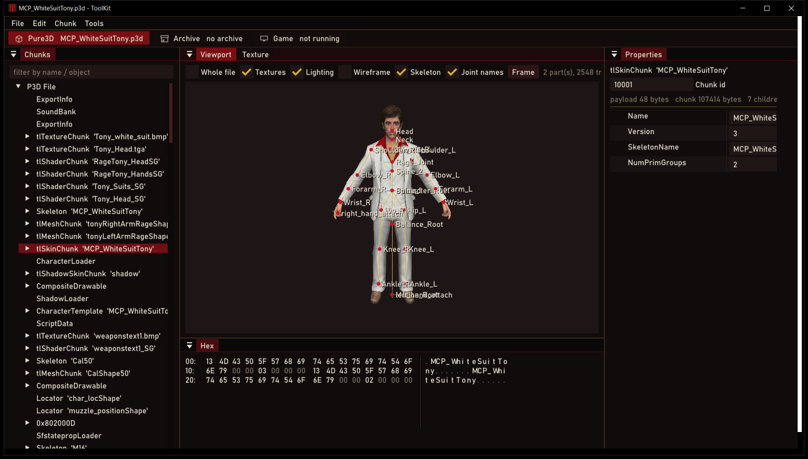
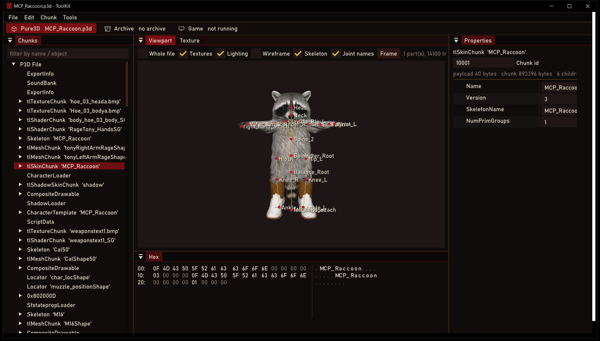
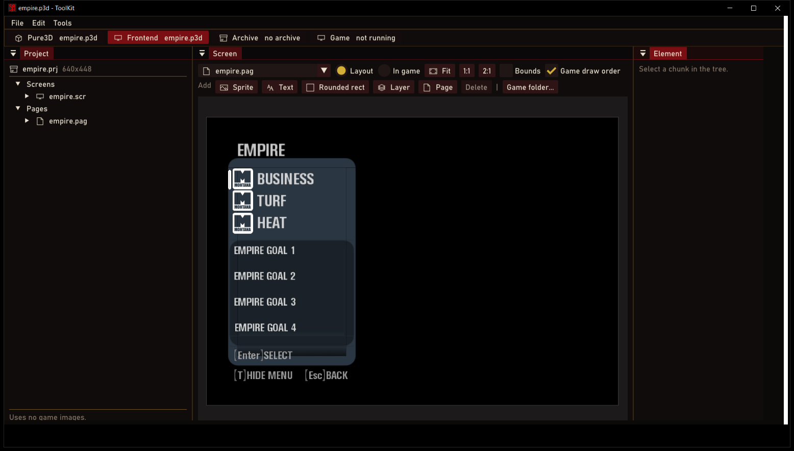
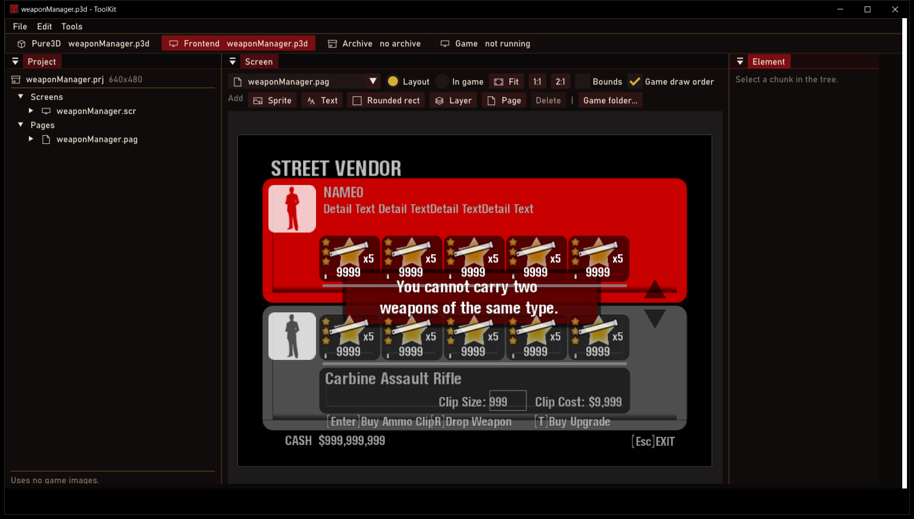
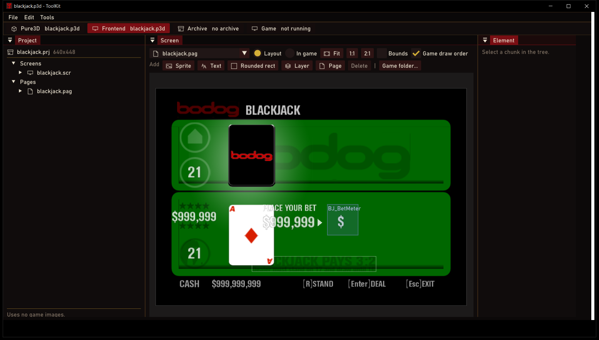
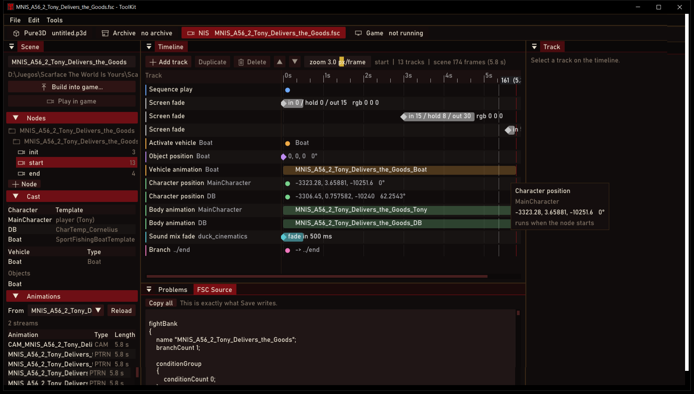

# ToolKit

Modding toolkit for Scarface: The World Is Yours (PC).

| Workspace | Opens |
|---|---|
| Pure3D | `.p3d` models, textures and skeletons |
| Frontend | menus and HUD (`frontend/*.p3d`) |
| Archive | `.rcf` archives |
| Game | the running game's menus and HUD, live |
| NIS | cutscenes (`art/nis/fsc/*.fsc`) |

## Screenshots

| | |
|---|---|
|  |  |
| Pure3D: Tony with his skeleton | Character import: a custom model on the game's skeleton |
|  |  |
| Frontend: the Empire menu | Frontend: the street vendor |
|  |  |
| Frontend: blackjack | NIS: a cutscene timeline |

## Installation

1. Download [ToolKit.zip](https://github.com/GangstaTeam/ToolKit/releases/latest/download/ToolKit.zip).
2. Extract it anywhere and run `ToolKit.exe`.
3. For the Game workspace, copy `plugins/ToolKitLink.asi` into the game's `plugins` folder.

> [!NOTE]
> The Game workspace needs the v1.00.2 game executable and an ASI loader.
